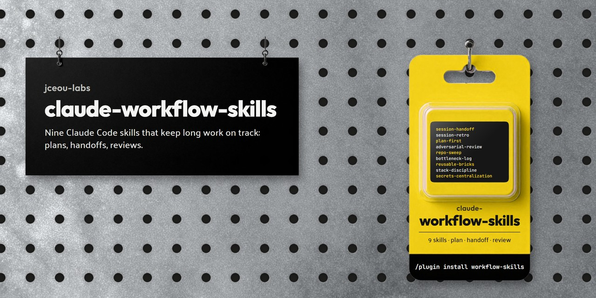

# Claude workflow skills

Nine skills for Claude Code that keep long pieces of work on track: across sessions, across compactions, and across projects.



Each one is a plain `SKILL.md`. Claude loads it when the situation calls for it, or when you ask by name.

## The skills

**Across sessions**

| Skill | What it does |
|---|---|
| `session-handoff` | Closes a session with a verified status (what is done, what was only tried, what is left) in `HANDOFF.md`, and picks it up again in the next one. |
| `session-retro` | A retrospective of one session: what cost time or tokens, which fix goes where, and frank feedback on how the session was steered. |
| `plan-first` | Writes the plan to disk before any code, in phases with exit gates, and logs structural decisions as ADRs. Survives compaction. |

**Reviewing and cleaning up**

| Skill | What it does |
|---|---|
| `adversarial-review` | Has a plan, a diff or an infrastructure change attacked by independent reviewers with distinct angles, and keeps only demonstrated problems. |
| `repo-sweep` | Sweeps a repository for unfinished work (forgotten TODOs, disabled tests, docs describing code that is gone) and sorts it into a backlog. |

**Across projects**

| Skill | What it does |
|---|---|
| `bottleneck-log` | Logs friction that comes back from one project to the next, and requires a permanent fix on the second occurrence. |
| `reusable-bricks` | Extracts the generic part of an app into a decoupled brick on its second real use. |
| `stack-discipline` | Keeps one default stack and one deployment target, and makes every exception justify itself. |
| `secrets-centralization` | Inventories API keys and env vars without ever printing a value, then moves them to one partitioned source with rotation. |

The skills refer to each other where they meet (a plan goes through `adversarial-review`, a retro sends cross-project friction to `bottleneck-log`), so they work best installed together.

## Install

At the prompt of a Claude Code terminal session:

```
/plugin install workflow-skills --marketplace jceou-labs/claude-workflow-skills
```

Answer `y` to add the marketplace, then pick a scope (Enter keeps the user scope, so the skills are there in every session).

From a shell:

```
claude plugin install workflow-skills --marketplace jceou-labs/claude-workflow-skills
```

In the desktop app: click + next to the prompt box, then Plugins, Add marketplace with `jceou-labs/claude-workflow-skills`, then Add plugin.

## See also

- [claude-context](https://github.com/jceou-labs/claude-context): a context gauge above the Claude Code prompt, with Compact and Handoff note buttons.
- [claude-project-tracker](https://github.com/jceou-labs/claude-project-tracker): offline pages showing where your projects stand, kept up to date by Claude.
- [claude-local-images](https://github.com/jceou-labs/claude-local-images): lets Claude generate images on your own graphics card, free and private.

## License

MIT
